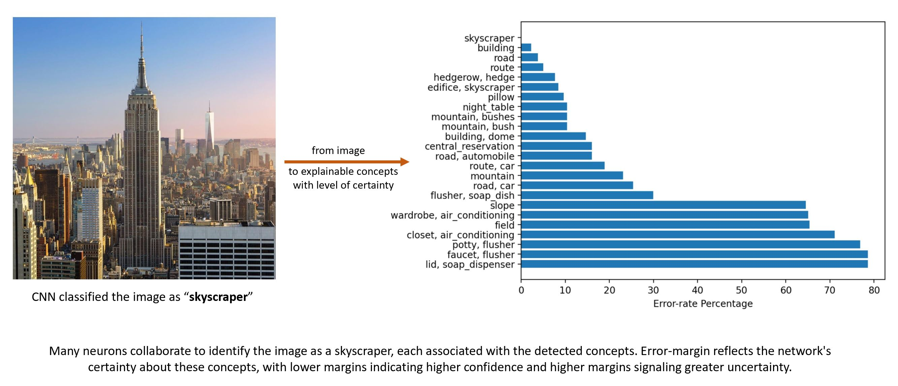

# ConceptLens: from Pixels to Understanding



## Summary

ConceptLens visualizes hidden-neuron activations using a CNN and symbolic methods. Its error-margin analysis helps explain what activates neurons and how they respond to image stimuli.

The Streamlit interface accepts images and produces concept and Grad-CAM visualizations. The CNN is trained on 10 scene classes: bathroom, bedroom, building facade, conference room, dining room, highway, kitchen, living room, skyscraper, and street. Results may be less meaningful for images outside these categories.

For a deeper explanation, see the [*Research Paper*](https://arxiv.org/abs/2405.09580), "Error-margin Analysis for Hidden Neuron Activation Labels."

## Environment setup

Use Python 3.10 (the version compatible with the pinned TensorFlow 2.13 dependency) and create an isolated environment.

1. Clone the repository and enter it:

    ```bash
    git clone <repository_url>
    cd <repository_directory>
    ```

2. Create and activate a virtual environment:

    ```bash
    python -m venv .venv
    # Windows PowerShell
    .\.venv\Scripts\Activate.ps1
    # macOS/Linux
    source .venv/bin/activate
    ```

3. Install the pinned application dependencies:

    ```bash
    pip install -r requirements.txt
    ```

The included `model_resnet50V2_10classes_retest2023June.h5` is used directly for prediction and Grad-CAM. No additional CNN or ImageNet weights are downloaded.

## Run the Streamlit application

```bash
streamlit run Home.py
```

## Run batch experiments

Place local JPEG, JPG, or PNG sources in `input_images/` (or provide another directory), then run:

```bash
python batch_process.py --input-dir input_images --output-dir batch_results --seed 42
```

The supported Gaussian-noise levels are `0`, `10`, `20`, `30`, `40`, `50`, and `80` percent. The protocol maps a percentage `p` to `sigma = (p / 100) * 40` in 8-bit pixel-intensity units. A zero-noise artifact is saved for reporting, while the original source is used for its zero-noise inference.

`batch_results/processing_manifest.json` is an atomic processing ledger. It records each image's relative path, content-hash version, per-noise-level status, attempt ID, and errors. A normal rerun processes only failed or missing levels for the current source content; completed conditions are skipped. `--new-only` processes only source-content versions not already represented in the manifest and does not retry known failures. `--rerun` deliberately selects all levels for the current versions.

### Artifact names and safe retries

The manifest distinguishes changed source content, but generated artifacts currently use the source file's simple stem (for example, `photo_noise_10.jpg`). Therefore, changing an image in place or using two files with the same stem can collide with existing artifacts. The runner refuses to overwrite those files; this preserves existing results, but `--rerun` will fail clearly once a matching artifact exists.

For now, use a new output directory when rerunning changed input content, and avoid duplicate stems in one input tree. A safe future enhancement would retain readable filenames while adding a short, stable suffix derived from the relative path and source hash (for example, `photo__a1b2c3d4_noise_10.jpg`). This would allow changed versions and retries to coexist while keeping the manifest references unambiguous. It would require a migration/compatibility plan for existing result paths and CSV/manifest references, so it is intentionally not implemented here.

`input_images/`, `batch_results/`, and Streamlit-generated `uploads/` are local/generated directories and are ignored by Git. Repository example images remain at the project root.
